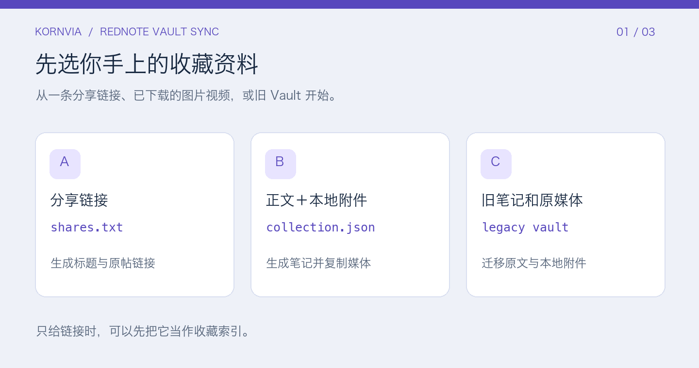
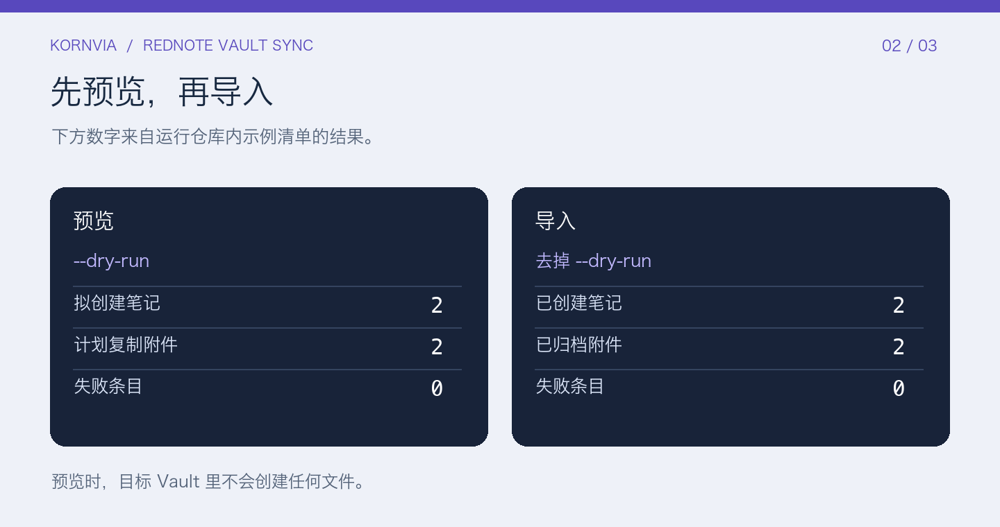
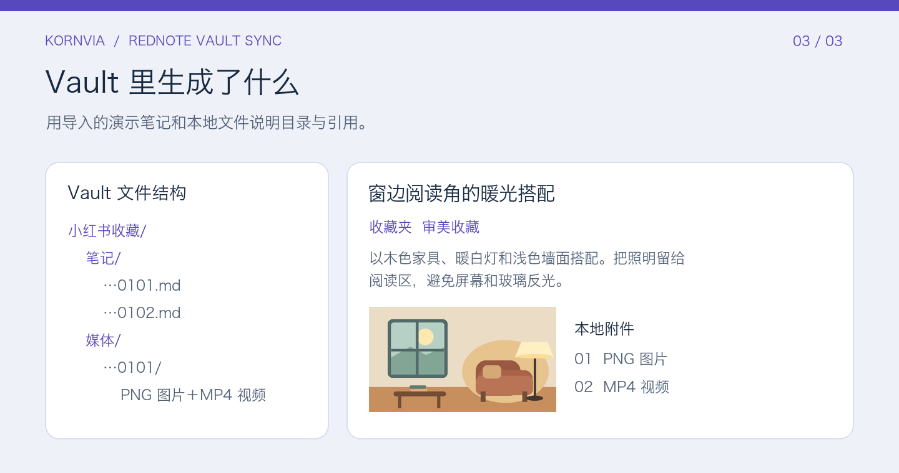

# RedNote Vault Sync

**Kornvia · MIT**

把小红书收藏整理成 Obsidian 笔记，把已有的图片和视频放进同一个 Vault。可在 Codex 中用 Skill 操作，也可直接运行 Python 脚本。

## 安装到 Codex

在你使用 Codex 的项目目录运行以下命令。需要带有 gh skill install 的 GitHub CLI。

~~~bash
gh skill install isook527/rednote-vault-sync rednote-vault-sync --agent codex --scope project --pin v1.0.1
~~~

也可以下载源码，把完整的 [skills/rednote-vault-sync](skills/rednote-vault-sync/) 文件夹复制到项目的 .agents/skills/，再打开一个新 Codex 会话。已有同名 Skill 时，先检查现有版本。

在 Codex 中输入：

> 用 $rednote-vault-sync 预览我的 collection.json，把笔记和本地媒体归档到「我的知识库」Vault。告诉我会新增多少条，有哪些附件缺失。

确认预览后，告诉 Codex 执行写入。你也可以在同一请求中明确授权写入并要求先预览。

## 跑一次演示

需要 Python 3.9 或更新版本。从仓库根目录运行。演示链接用于展示字段和结构。

~~~bash
mkdir -p demo-vault
python3 skills/rednote-vault-sync/scripts/import_rednote.py \
  --format json --source examples/collection.json --vault demo-vault --dry-run
python3 skills/rednote-vault-sync/scripts/import_rednote.py \
  --format json --source examples/collection.json --vault demo-vault
~~~

在 Obsidian 的 Vault 切换器中用「打开文件夹作为仓库」选择 demo-vault。打开「小红书收藏 → 笔记」里的 …0101.md。笔记上方是收藏夹、作者和来源，下方引用 Vault 里的 PNG 和 MP4。

## 换成自己的收藏

- **分享链接**。在小红书点分享并复制链接或分享文案，粘贴到 UTF-8 文本，每行一条。把命令中的 --format 改为 shares，--source 指向文本，可加 --collection 指定收藏夹。只有链接时，生成可回看原帖的索引笔记。
- **正文、图片和视频**。复制 [示例清单](examples/collection.json)，填入标题、正文、收藏夹和来源链接。把已有的附件放在清单所在目录或子目录，在 media 字段中填写相对路径。
- **旧插件笔记**。保留旧 Vault 的目录结构，使用 --format legacy，--legacy-vault 指向旧 Vault，--source 指向它里面的旧笔记目录，--vault 指向目标 Vault。远程媒体和不支持的嵌入会计入报告。

更完整的字段说明、错误处理与去重规则见 [导入格式](skills/rednote-vault-sync/references/import-format.md)。

同一篇收藏有多种来源时，优先导入含正文和附件的清单或旧笔记，再导入其余分享链接。若此前已导入链接索引，可用 --folder 将完整笔记写到另一个目录。\n\n脚本在本地运行。它不会登录小红书、扫描收藏夹或下载网络媒体。重复导入按 ID 跳过既有路径，保留手动编辑。请只提供你有权使用的内容和媒体，并把示例目录与自己的 Vault 分开。

## 开发

~~~bash
python3 -B -m unittest discover -s tests -v
~~~

[源码与演示素材来源](SOURCES.md) · [MIT License](LICENSE)
