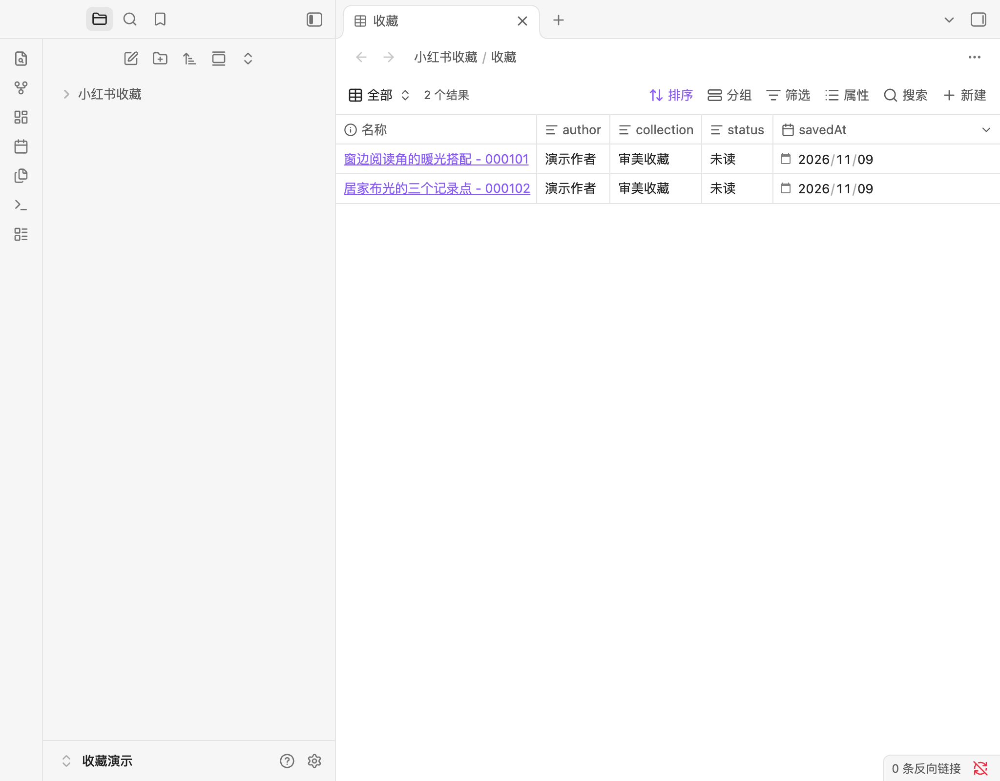
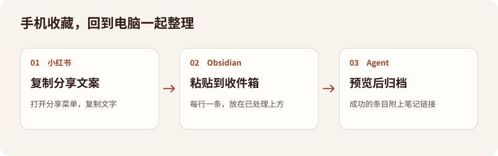

# RedNote Vault Sync

把小红书分享文案和本地图片、视频整理成 Obsidian 笔记。之后还能补到同一篇、保留手写笔记，按收藏夹查看或按关键词找回。



导入脚本全程离线，只处理你提供的文件。它不会抓取小红书、登录、读取账号收藏或访问分享链接。

## 30 秒试用

解压完整发布包，在包的根目录用 Python 3.9 或更新版本运行：

```bash
python3 scripts/demo.py
```

Windows PowerShell 使用 `py -3 scripts/demo.py`。无需安装依赖。脚本会生成 `demo-vault`，包含两篇笔记、一张图、一段视频、索引和收藏表格。用 Obsidian 的「打开本地仓库」选择这个文件夹，打开 `小红书收藏/收藏.base`。在没有启用 Bases 的 Vault 中，打开 `索引.md`。

## 安装

| 平台 | 安装步骤 |
| --- | --- |
| Codex | 把完整的 `skills/rednote-vault-sync` 文件夹复制到项目的 `.agents/skills/`，或复制到 `~/.agents/skills/` 供所有项目使用。在该项目中开启对话，输入 `$rednote-vault-sync` 或直接描述任务。 |
| Claude Code | 把同一文件夹复制到项目的 `.claude/skills/`，或复制到 `~/.claude/skills/` 供所有项目使用。可在项目中输入 `/rednote-vault-sync`。 |
| Claude 网页或桌面 | 下载独立的 `rednote-vault-sync-skill-v1.3.1.zip`，在 **Customize → Skills** 选择添加或上传 Skill。需要具备自定义 Skills 和代码执行权限。在远程沙盒中，只能处理你明确提供给 Claude 的文件，可请它返回结果，再由你放入本地 Vault。 |

独立 Skill zip 解压后也可用于前两种安装。命令行试用和使用 Skill 是两条独立的入口。官方说明见 [Codex Skills](https://learn.chatgpt.com/docs/build-skills)、[Claude Code](https://code.claude.com/docs/en/skills)、[Claude 自定义 Skills](https://support.claude.com/en/articles/12512180-use-skills-in-claude)。

## 可以直接这样说

- “把这几条小红书分享文案归档到我的 Obsidian。第一条配这两张图，先给我看预览。”
- “这篇昨天存过，把正文和截图补进原笔记，保留我写的批注。”
- “我收藏过哪些讲窗边布光的笔记？每条带上笔记链接。”

只提供分享链接也能建档。等你拿到正文或截图，再提供同一条链接补进原笔记。整理摘要和转写时，agent 会先依据现有内容制作本地 JSON，再给你看写入预览。

## 手机收件箱



1. 对 agent 说“在这个 Vault 建一个小红书收件箱”。确认后，它会创建 `小红书收藏/收件箱.md`。
2. 手机端在小红书复制分享文案，到同一个 Obsidian Vault 的收件箱里粘贴，每行一条，放在「已处理」上方。如果手机和电脑分别保存 Vault，需用你自己的同步方式或把文件复制到电脑。
3. 回到有 Vault 文件访问权限的 agent，说“预览并处理收件箱”。确认写入后，成功的条目附日期和笔记链接移到「已处理」，失败项留在原处并注明原因。

## 常见问题

- **Windows 和中文路径**　使用 `py -3`。路径有空格时用双引号括起来，分享文本保存为 UTF-8。
- **视频无法播放**　先用 Obsidian 阅读视图查看，再尝试用系统播放器打开 Vault 内的本地文件。若是编码兼容性问题，可转成常见的 MP4（H.264/AAC）后再补入同一篇。
- **短链和直链看起来像同一篇**　离线无法推断关系。确认对应后，在本地映射表登记，后续按同一帖子 ID 识别。
- **怎么撤销**　把本次 JSON 报告和原 Vault 路径交给 agent，先预览撤销范围。编辑过的文件会保留。默认报告在 `小红书收藏/.导入记录/`。
- **旧笔记还用 ID 命名**　原文件名会保留，后续补全按 `sourceId` 匹配。新笔记默认采用「标题 - ID 后六位」。

[Skill](skills/rednote-vault-sync/SKILL.md) · [全部参数](skills/rednote-vault-sync/references/import-format.md) · [整理、回忆与收件箱](skills/rednote-vault-sync/references/organize-and-recall.md) · [隐私](PRIVACY.md) · [更新记录](CHANGELOG.md)

本项目由 **Kornvia** 制作，以 [MIT](LICENSE) 开源。项目与小红书（行吟信息科技）无关联。「小红书」和「RedNote」为其各自所有者的商标。请遵守原作者的版权和平台规则，将用户提供的本地资料用于个人学习和参考。
